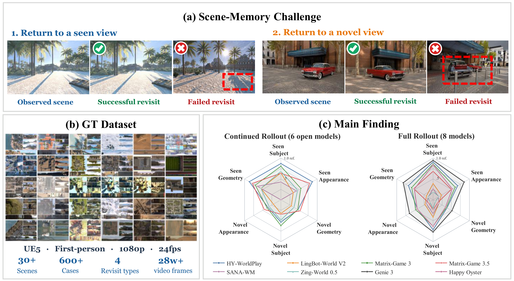

<div align="center">

# SceneMemBench

### A Benchmark for Scene Memory in Interactive Video World Models

**Can a world model remember a scene after it leaves the view?**

[Project Page](https://yuheng-si.github.io/SceneMemBench/) · [Dataset](https://huggingface.co/datasets/scenemembench/SceneMemBench) · arXiv (coming soon)

</div>

<p align="center">
  
</p>

<p align="center"><sub><b>SceneMemBench at a glance.</b> Scene-memory challenges, benchmark data, and dimension-wise model profiles.</sub></p>

Continuation inference and evaluation for scene memory in interactive world models.

## Quickstart

Python 3.10+; Python 3.11 recommended for native models.

```bash
python -m venv .venv
source .venv/bin/activate
pip install -e .

# Create synthetic examples and generate a CPU test video.
scenemembench demo --output data/demo
scenemembench run --model toy --device cpu \
  --case data/demo/reversed_rotation --output outputs/toy

# Evaluate PSNR and SSIM.
scenemembench evaluate --task seen \
  --case data/demo/reversed_rotation \
  --prediction outputs/toy/continuation.mp4 \
  --output outputs/toy/metrics.json
```

`toy` and the synthetic examples verify the pipeline; they are not benchmark results.
For a Novel-view case, use `--task novel` with the corresponding case and prediction.

## Evaluate all six metrics

Install `pip install -e '.[metrics]'` and [Depth Anything 3](docs/evaluation.md), then run:

```bash
scenemembench evaluate --task seen --metrics all --device cuda:0 \
  --model-id hy-worldplay \
  --case /path/to/case \
  --prediction /path/to/continuation.mp4 \
  --da3-model /path/to/DA3NESTED-GIANT-LARGE-1.1 \
  --output outputs/metrics.json
```

Metrics: DINOv2, LPIPS, SSIM, PSNR, depth SI-AbsRel, and normal cosine.
Set `--model-id` to the model that generated the prediction.

## Run a native model

Prepare the model environment and weights using [native setup](docs/native_backends.md).
For HY-WorldPlay:

```bash
export SCENEMEMBENCH_CKPT_DIR=/path/to/checkpoints
scenemembench run --model hy-worldplay --device cuda:0 \
  --config configs/models/hy-worldplay.yaml \
  --case /path/to/case --output outputs/hy
```

Backend IDs: `hy-worldplay`, `lingbot-world-v2`, `matrix-game-3`,
`matrix-game-3.5`, `sana-wm-streaming`, `zing-world-0.5`.

[Data format](data/README.md) · [Validation status](docs/validation.md) ·
[Third-party licenses](THIRD_PARTY_NOTICES.md)
